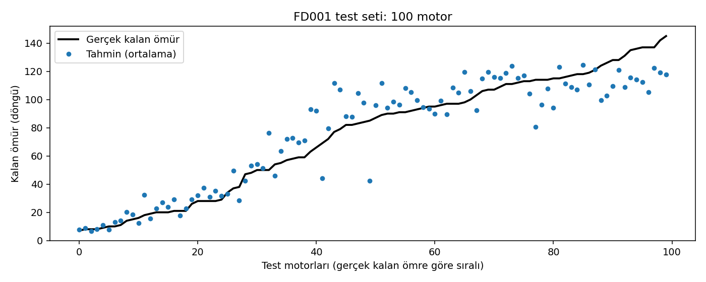
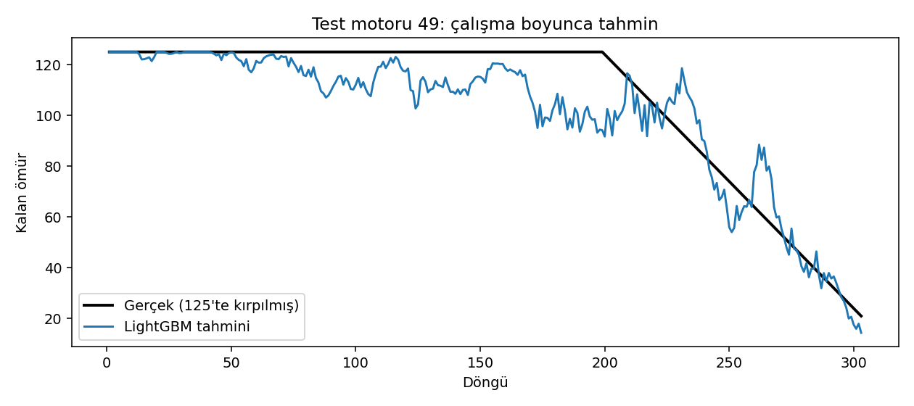
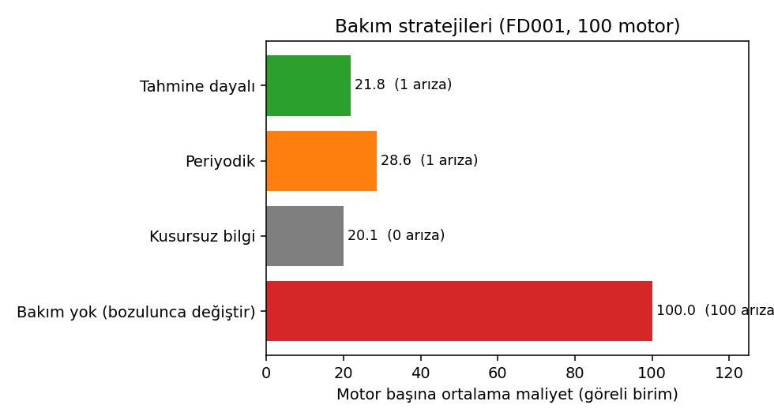

# Kestirimci Bakım: Turbofan Motorlarda Kalan Ömür Tahmini

Uçak motorlarının sensör verilerinden **arızaya kaç döngü kaldığını** (RUL, remaining useful life) tahmin eden ve bu
tahmine göre **ne zaman bakım yapılacağına** karar veren bir sistem.

Klasik bakım ya motor bozulunca (pahalı, tehlikeli) ya da her X saatte bir (sağlam parçalar da erken değişiyor)
yapılıyor. Kestirimci bakımda motorun durumuna bakılıyor; bu projede ikisini maliyet üzerinden karşılaştırdım.

- C-MAPSS'in dört alt kümesinde **LightGBM** (pencere özellikleri) ve **1D-CNN** karşılaştırması
- Çoklu uçuş koşulunda koşula göre normalleştirme
- **Bakım stratejisi analizi:** tahmine dayalı bakım vs periyodik bakım vs bakım yapmama, motor başına maliyet
- FastAPI servisi (sensör geçmişi → kalan ömür + bakım önerisi), testler, Dockerfile

## Veri

NASA Prognostics Center of Excellence'ın [C-MAPSS](https://phm-datasets.s3.amazonaws.com/NASA/6.+Turbofan+Engine+Degradation+Simulation+Data+Set.zip)
turbofan motor bozulma simülasyonu. Eğitimdeki her motor bozulana kadar çalışıyor; test motorlarının kaydı
arızadan önce bir yerde kesiliyor ve o andaki kalan ömrü tahmin etmek gerekiyor. 21 sensörden bilgi taşıyan 14'ü kullanıldı.

| Alt küme | Çalışma koşulu | Arıza türü | Eğitim motoru | Test motoru |
| --- | --- | --- | --- | --- |
| FD001 | 1 | 1 | 100 | 100 |
| FD002 | 6 | 1 | 260 | 259 |
| FD003 | 1 | 2 | 100 | 100 |
| FD004 | 6 | 2 | 249 | 248 |

Literatürdeki standart yaklaşımla kalan ömür 125 döngüde kırpıldı: motorun ilk dönemi sağlıklı ve sensörlerde
bozulma izi yok, o dönemde "kalan ömür 300 mü 250 mi" sorusunun cevabı yok.

## Yöntem

- **Normalleştirme:** FD002 ve FD004'te sensör değerleri uçuş koşuluna (irtifa, hız, gaz) göre çok değişiyor.
  Uçuş ayarlarını K-means ile 6 koşula ayırıp her koşul içinde ayrı standartlaştırdım.
- **LightGBM:** her döngü için son 30 döngünün her sensörde son değeri, ortalaması, standart sapması ve eğimi (56 özellik), ayrıca döngü sayısı ve çalışma koşulu.
- **1D-CNN:** son 30 döngünün ham sensör dizisi üzerinde 3 evrişim katmanı, 3 farklı tohumla eğitilip ortalaması.
- Eğitim motorlarının %20'si doğrulama (erken durdurma) için ayrıldı; aynı motorun döngüleri iki tarafa bölünmedi.

## Sonuçlar (test motorları)

RMSE (döngü) ve NASA skoru (geç tahmini, yani ömrü olduğundan uzun sanmayı daha ağır cezalandırıyor). İkisinde de düşük daha iyi.

| Model | FD001 | FD002 | FD003 | FD004 |
| --- | --- | --- | --- | --- |
| **LightGBM** | **14,07** / 275 | **25,02** / 6.132 | **13,56** / 281 | **26,01** / 4.627 |
| 1D-CNN | 15,82 / 444 | 27,46 / 9.927 | 15,56 / 432 | 28,35 / 5.668 |
| Ortalama | 14,25 / 298 | 25,82 / 7.342 | 13,79 / 295 | 26,68 / 4.719 |
| *LSTM (Zheng ve ark., 2017)* | *16,14* | *24,49* | *16,18* | *28,17* |
| *Derin CNN (Li ve ark., 2018)* | *12,61* | *22,36* | *12,64* | *23,31* |

- LightGBM dört alt kümede de CNN'den iyi ve eğitimi 0,5 saniyeden kısa (CNN 9-18 saniye). Elle hazırlanan pencere
  özellikleri (eğim, değişkenlik) bu veri boyutunda derin ağın kendi öğrendiklerinden daha etkili oldu.
- Literatürle karşılaştırınca 2017'deki LSTM'i tek koşullu kümelerde geçiyor, 2018'deki derin CNN'in 1-3 RMSE gerisinde.
- Çok koşullu kümeler (FD002, FD004) belirgin şekilde daha zor; koşula göre normalleştirme yapılmazsa hata çok daha yüksek.





## Bakım kararı

Bir strateji ancak motor bozulana kadar izlenerek sınanabilir, ama test motorlarının kaydı arızadan önce kesiliyor.
Bu yüzden FD001'in 100 eğitim motorunun tüm ömrü için **çapraz tahmin** ürettim: motorlar 5 gruba bölündü, her grup
diğer 4 grupla eğitilen modelle tahmin edildi (bu tahminlerin RMSE'si 12,0). Strateji eşikleri de aynı şekilde,
her grup için diğer gruplarda seçildi.

Maliyet varsayımları (göreli): plansız arıza 100, planlı bakım 20, bakımda kullanılmadan bırakılan her döngü 0,1.

| Strateji | Motor başına maliyet | Arıza | Boşa giden ortalama ömür |
| --- | --- | --- | --- |
| Bakım yok (bozulunca değiştir) | 100,0 | 100 / 100 | |
| Periyodik (her ~127 döngüde bir) | 28,6 | 1 / 100 | 78,8 döngü |
| **Tahmine dayalı** (tahmin ≤ 11 döngü olunca) | **21,8** | 1 / 100 | 10,1 döngü |
| Kusursuz bilgi (teorik alt sınır) | 20,1 | 0 / 100 | 1,0 döngü |

Tahmine dayalı bakım, periyodik bakıma göre motor başına maliyeti %24 düşürüyor; ulaşılabilecek en iyi duruma kadar
olan farkın %80'ini kapatıyor. Asıl kazanç boşa giden ömürde: periyodik bakımda parçalar ortalama 79 döngü erken
değişirken tahmine dayalıda 10 döngü erken değişiyor. Her iki stratejide de 100 motordan biri bakımdan önce bozuldu.



## API

```bash
uvicorn api.app:app      # http://127.0.0.1:8000/docs
```

| Uç nokta | Açıklama |
| --- | --- |
| `GET /saglik` | Servis durumu, bakım eşiği, beklenen sensörler |
| `POST /motor` | Döngü sırasıyla sensör ölçümleri → kalan ömür, durum, son 10 döngünün tahmini |

Durumlar: `sağlıklı` (> 80 döngü), `izlenmeli` (30-80), `bakım planla` (11-30), `hemen bakım` (≤ 11).
Bozulmasına 7 döngü kalmış bir test motoru için cevap:

```json
{"kalan_omur": 9.0, "durum": "hemen bakım", "bakim_esigi": 11,
 "son_10_dongu_tahmini": [16.5, 14.5, 13.8, 13.1, 12.8, 12.1, 11.4, 10.8, 10.5, 9.0]}
```

Docker ile:

```bash
docker build -t bakim-api .
docker run -p 8000:8000 bakim-api
```

## Çalıştırma

```bash
python -m venv .venv
.venv\Scripts\activate          # Linux/macOS: source .venv/bin/activate
pip install -r requirements.txt
```

Yukarıdaki bağlantıdan zip'i indirip içindeki `CMAPSSData.zip`'i `data/cmapss/` altına açın.

```bash
python -m src.egit       # 4 alt küme, LightGBM ve CNN, test sonuçları
python -m src.bakim      # bakım stratejisi analizi ve servis eşiği
pytest
```

## Klasör yapısı

```
src/
  veri.py          okuma, RUL etiketleri, koşula göre normalleştirme, motor bazında bölme
  ozellikler.py    pencere özellikleri (LightGBM) ve diziler (CNN)
  cnn.py           1D-CNN
  metrikler.py     RMSE, NASA skoru
  egit.py          eğitim ve test karşılaştırması
  bakim.py         çapraz tahmin, bakım stratejileri, maliyet
  cikarim.py       tek motor tahmini (API için)
api/app.py         FastAPI servisi
tests/             API testleri
models/            FD001 LightGBM, CNN ağırlıkları, normalleştirici, bakım eşiği
reports/           sonuçlar ve grafikler
```

## Sınırlamalar

- Veri simülasyon; gerçek motorlarda sensör gürültüsü, eksik veri ve bakım geçmişi gibi ek zorluklar var.
- Servis yalnızca FD001 (tek çalışma koşulu, tek arıza türü) modeliyle çalışıyor.
- Tahminler tek bir sayı; arıza riski için bir güven aralığı (ör. yüzdelik regresyon) bakım kararını daha sağlam yapar.
- Maliyet oranları varsayım; gerçekte havayolunun bakım ve arıza maliyetlerine göre ayarlanmalı.

## Kaynaklar

- A. Saxena, K. Goebel, D. Simon, N. Eklund. *Damage Propagation Modeling for Aircraft Engine Run-to-Failure Simulation.* PHM 2008.
- S. Zheng ve ark. *Long Short-Term Memory Network for Remaining Useful Life Estimation.* IEEE ICPHM 2017.
- X. Li, Q. Ding, J.-Q. Sun. *Remaining Useful Life Estimation in Prognostics Using Deep Convolution Neural Networks.* Reliability Engineering & System Safety, 2018.

## Yazar

Batın Dikilitaş, Kocaeli Üniversitesi Yapay Zeka ve Makine Öğrenmesi
